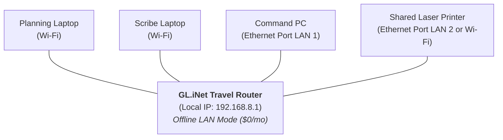
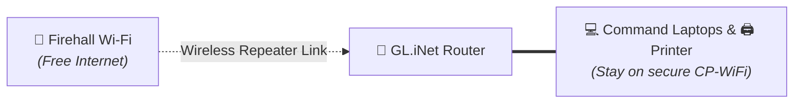

# GL.iNet Travel Routers for Command Posts

When outfitting an Incident Command Post (ICP) or command truck, search teams need a dependable local network. Search managers need to send tasking sheets to a shared printer, planning laptops need to share map data, and everyone needs internet when it becomes available.

While commercial mobile routers (like Peplink or Cradlepoint) are popular in high-budget emergency vehicles, they often cost $1,500 to $3,000 plus ongoing software licenses. 

For volunteer SAR teams operating on community donations and grants, **consumer travel routers from GL.iNet** have emerged as an affordable, reliable workhorse. For roughly $60 to $130, these pocket-sized routers provide flexible routing features, multiple uplink options, and low power consumption.

---

## Why Travel Routers Fit Ground SAR

GL.iNet routers run on **OpenWrt** (an open-source Linux router system) with a simple, friendly web interface. They solve several unique headaches for mobile command posts:

- **Low Power & USB-C**: Most models run directly on 5V USB-C or 12V DC power. You can run the entire command post network off a small USB power bank or vehicle auxiliary socket without turning on an inverter or gas generator.
- **Dedicated Local Wi-Fi ("CP-WiFi")**: Creates a permanent, secure private network for your team's laptops, desktops, and printers.
- **Repeater Mode**: Wirelessly connects to outside Wi-Fi (such as a firehall or school) and feeds that internet to your team without changing any settings on your computers.
- **Phone Tethering**: Allows you to plug an Android or iPhone directly into the router with a USB charging cable to share cell data.
- **Physical Network Ports**: Provides standard Gigabit Ethernet ports to hardwire desktop computers or network printers.
- **PHysical uplink** You can wire in your Starlink, Cellular router, or any other network connection for a stable connection to the outside world

---

## 1. Setting Up the Local Network ("CP-WiFi")

The first job of your router is to establish an **offline-first local network (LAN)** that works anywhere, even in a deep valley with zero cell reception.

### Initial Configuration Steps

1. **Power on the Router**: Connect the included USB-C cable to a power source.
2. **Access the Admin Panel**: Connect a laptop to the default Wi-Fi printed on the router bottom label, open a browser, and navigate to `192.168.8.1`.
3. **Set Admin Password**: Choose a strong administrator password for the team.
4. **Set Up the Operational Wi-Fi (SSID)**:
    - Go to **Wireless** settings.
    - Set a clear network name, such as `YSSR-Command-WiFi` or `SAR-CP-NET`.
    - Set a strong WPA2/WPA3 password.
5. **Connect Team Equipment**:
    - Connect each team laptop and tablet to this Wi-Fi once and check "Connect Automatically".
    - Plug your shared colour laser printer into one of the router's LAN ports (or join it to `CP-WiFi`).
    - Print a test tasking sheet from two different laptops to confirm printer sharing works without internet.

!!! tip "The Pre-Configured Fleet Advantage"
    Because your laptops, desktops, and printer are permanently paired to the GL.iNet router, **everything talks together the second you flip the power switch**. Searchers never have to scramble with network cords or USB flash drives at 02:00.

---

## 2. Using Repeater Mode

Many ground searches stage at a local fire station, community centre, arena, or church. These buildings often have fast, stable, and free Wi-Fi.

If searchers try to connect each of their laptops individually to the building's Wi-Fi, problems arise:
- **Printer Sharing Breaks**: Most municipal and public Wi-Fi networks turn on "Client Isolation" for security, which stops laptops from seeing other laptops or printers on the network.
- **Wasted Time**: Typing complex Wi-Fi passwords into 4 to 8 different machines burns valuable operational time during initial callout.
- **Wired Devices Left Out**: Desktop computers or older printers without Wi-Fi cannot connect at all.

### How Repeater Mode Solves This

With **Repeater Mode**, your GL.iNet router wirelessly joins the firehall's Wi-Fi as an internet source. It then routes that internet through to your existing `CP-WiFi` network.

### Connecting to a Staging Area Wi-Fi

1. Open your browser on any command laptop and go to `192.168.8.1`.
2. On the main dashboard, click **Internet** > **Repeater** > **Scan**.
3. Select the building's Wi-Fi network from the list.
4. Enter the password and click **Connect**.
5. Within 15 seconds, all laptops and computers on `CP-WiFi` will have full internet access. The printer and local network connections remain completely undisturbed.

!!! tip "Pre-Program Known Staging Locations"
    GL.iNet routers remember previous networks. During training nights or routine visits, connect your router to the guest Wi-Fi at your local fire halls, municipal offices, and scout camps. When your command truck arrives on a call at that location in the future, the router will connect to their Wi-Fi automatically.

---

## 3. Cellular Uplink: USB Phone Tethering

When staging along a highway or forest service road with cell service, you can bring internet into the command post using a smartphone or dedicated mobile hotspot.

While you can repeat a phone's personal Wi-Fi hotspot, **USB Tethering** is significantly better for operational use:

### Why USB Tethering Is Better

- **Powers the Phone**: The router's USB port charges the smartphone while it shares data, preventing the phone battery from dying during a long search.
- **Reduces Radio Interference**: The metal frame of a command truck or trailer is a hostile radio frequency environment. Plugging the phone in via cable removes an unnecessary Wi-Fi hop and frees up wireless spectrum for your laptops.
- **Reliable Speed**: Direct USB data transfer is faster and less prone to dropouts than wireless hotspotting.

### How to Enable USB Tethering

1. Connect the phone to the router's USB port with a quality data cable.
2. On Android: Go to **Settings** > **Network & Internet** > **Hotspot & Tethering** > enable **USB Tethering**.
3. On iPhone: Connect the cable, tap **Trust This Computer** if prompted, and enable **Personal Hotspot**.
4. In the GL.iNet admin panel under **Internet**, the router will automatically recognize the device under **Tethering** and connect immediately.

---

## Recommended Models for Ground SAR

GL.iNet offers several models. For search and rescue command post kits, three models stand out:

| Model | Price (CAD) | Key Features | Best Used For |
| :--- | :--- | :--- | :--- |
| **Beryl (GL-MT1600)** | ~$90 | Wi-Fi 5, compact pocket size, low power USB-C. | **Recommended standard** for command trucks and flyaway pelican kits. Fast, reliable, and portable. |
| **Slate AX (GL-AXT1800)** | ~$170 | Wi-Fi 6, 3 Gigabit ports (1 WAN, 2 LAN), quad-core CPU. | Command trucks with multiple hardwired desktops and heavy multi-user traffic. |
| **Opal (GL-SFT1200)** | ~$60 | Budget dual-band Wi-Fi, 3 Gigabit ports. | Ultra-low-cost backup unit to keep in a ready pack or training kit. |

---

## Practical Field Tips

- **Laminate the Network Details**: Stick a laminated label on the top of the router showing:
    - Admin IP: `192.168.8.1`
    - `CP-WiFi` Network Name and Password
    - Admin Panel Password
- **Toggle Switch Customization**: GL.iNet routers have a physical slide switch on the side. In the router settings, you can assign this switch to toggle OpenVPN/WireGuard, or quickly turn the Wi-Fi on and off.
- **Keep Two Ethernet Cables in the Pouch**: Always store two 10-foot Cat6 ethernet patch cables with the router. If a laptop's Wi-Fi card acts up during an ice storm, a physical cable will save the day.
- **Ventilation**: In enclosed command cabinets, ensure the router has a small amount of breathing room. While they do not run excessively hot, enclosing them in tight foam cases can cause thermal throttling under heavy data transfer.

---

## Related Resources

- [:material-arrow-right-circle: Command Post Networking & Internet Guide](icp-networking-guide.md) — The complete operational guide to field networks, data budgeting, and cost recovery.
- [:material-arrow-right-circle: Starlink for Ground SAR](starlink-for-gsar.md) — Deploying satellite broadband to the command router in remote areas.
