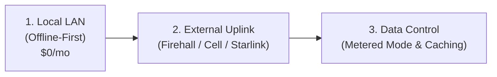
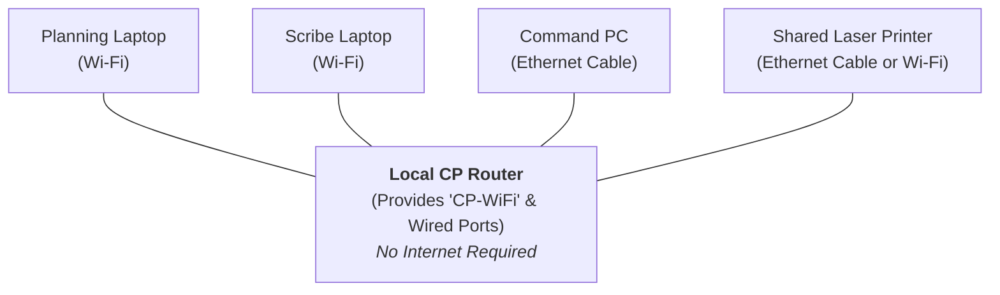
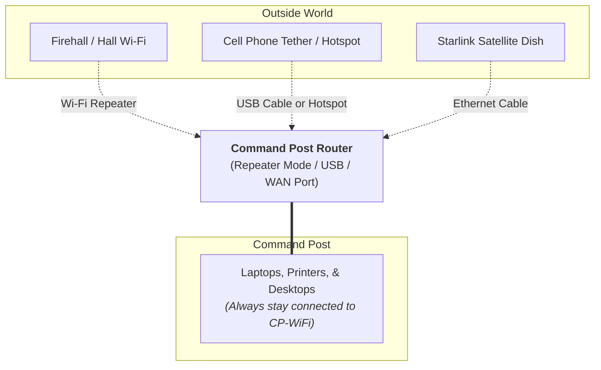

# Command Post Networking & Internet Guide

When a search team rolls up to an incident, the Command Post (CP) becomes the heartbeat of the mission. Search managers need to track field teams on digital maps, planning sections need to print tasking sheets, and incident commanders need to brief police and partner agencies.

Too often, teams assume that having a modern command setup requires a multi-thousand-dollar enterprise router (like a Peplink) or a dedicated IT specialist. 

This guide outlines a field-tested, budget-friendly approach built by active Canadian ground searchers. It shows how a volunteer team can set up a resilient local network for around $100, connect printers and laptops together without internet, bring in outside internet cleanly when available, and keep monthly data bills under control.

---

## The Four Stages of CP Networking

1. **Local Network First**: Make all CP computers, tablets, and printers talk together offline without relying on outside internet.
2. **Flexible Uplink**: Add outside internet using whatever connection is best on scene (a firehall Wi-Fi, a cell phone hotspot, or satellite).
3. **Data Budgeting**: Control data consumption so high-resolution mapping does not cause surprise bills.

---

## 1. The Offline Local Network (LAN)

The golden rule of search and rescue technology is: **always be able to work completely offline**.

Cell towers get congested or do not reach into deep valleys. Fiber lines can be cut during storms. Even if you have zero outside internet, your command post can still benefit enormously from a **Local Area Network (LAN)**.

### Why an Offline LAN Matters

When your command laptops and desktop computers are joined to the same local router, they can communicate with each other directly:

- **Shared Printing**: All search managers, scribes, and planners can send tasking forms and ICS paperwork to a single shared colour laser printer without passing around a USB flash drive or unplugging cords.
- **Collaborative Software**: Tools like **SAR Command Assist** or offline CalTopo instances can share data across local screens in real time.
- **Zero Ongoing Cost**: Once you own a basic router, running a local network costs **$0 per month**.

### The "CP-WiFi" Standard

Give your router a dedicated, permanent network name (SSID), such as `TEAMNAME-Command`, and protect it with a strong password. 

Save that network on all team-owned laptops, tablets, and printers. That way, as soon as the equipment powers on in the command truck, **every device connects automatically**—even in the middle of a remote logging road with zero cell service.

!!! tip "Keep the Command Network Secure"
    Do not give the primary `CP-WiFi` password out to converging volunteers or visitors. If you want to offer guest access, enable a separate "Guest" network on the router so non-operational traffic cannot access your printers or access command computers.

---

## 2. Bringing in the Outside World ("Hello Internet!")

While your team should be fully capable of running an incident offline, having internet access unlocks major benefits: high-resolution aerial and satellite layers, Google Street View, email briefings, weather radar, and direct synchronization with outside agencies.

In a mobile command post, your internet source changes with every call. A smart setup lets you change your outside connection **without changing a single setting on your laptops or printers**.

### The Three Best Uplink Methods

#### Method 1: Wi-Fi Repeater Mode (The Firehall / Community Centre Piggyback)
Many searches stage at a local fire station, community hall, school, or church. These buildings often have available Wi-Fi.

If each searcher reconnects their laptop to the building's Wi-Fi, two problems happen:
1. Devices can no longer talk to the CP printer (public and guest Wi-Fi networks block device-to-device communication for security).
2. You waste 15 minutes typing passwords into half a dozen machines.

Using a router with **Repeater Mode** (such as a GL.iNet travel router), you tell the *router* to connect to the firehall Wi-Fi. The router passes that internet through to your existing `CP-WiFi`. Your laptops and printers do not notice any change—they stay connected to each other, but suddenly have high-speed internet.

#### Method 2: Cellular Phone Tethering
When parked at a roadside with cell service, a smartphone can share its data connection:
- **Wi-Fi Hotspot**: The router connects wirelessly to the phone's hotspot.
- **USB Tethering**: Plug the phone directly into the router's USB port. This is cleaner because it powers your phone from the router and eliminates extra wireless interference inside the metal shell of a command truck.

#### Method 3: Portable Satellite (Starlink)
For remote incidents where cellular service does not exist, portable satellite (specifically Starlink) provides high-speed broadband anywhere in Canada. Plug the Starlink router or ethernet adapter directly into your command router's WAN port.

---

## 3. Managing Data Usage in Field Operations

Mobile data can get expensive quickly if it is not monitored. Understanding how much data your tools consume helps you choose the right plans and avoid overage charges.

### Bytes vs. Bits: A Quick Field Guide

- **Bytes (MB, GB)**: Used to measure **volume** (how much data is stored or downloaded). This is how data plans and phone bills are calculated.
- **Bits (Mbps, Gbps)**: Used to measure **speed** (how fast data travels). 8 bits make up 1 byte.
- When evaluating a cellular or satellite plan, always look at the **Gigabytes (GB)** of data included, not just the connection speed.

### How Much Data Does an Incident Use?

Based on some non-scientific observations on several individual 8-12 hour operational period in New Brunswick using common tools like CalTopo:

| Operational Activity | Typical Daily Usage | Notes |
| :--- | :--- | :--- |
| **Average Search Day** | **7 to 15 GB** | ~10 GB is a reliable benchmark for planning. |
| **First Hour of an Incident** | **2 to 3 GB** | High initial surge as multiple laptops load maps and satellite imagery. |
| **Text, Email & ICS Forms** | **< 100 MB** | Very light data footprint. |
| **High-Resolution Satellite Tiles** | **Heavy (GBs)** | The main source of data consumption on search calls. |

Because satellite map tiles are large, loading several different imagery layers across four different laptops can chew through a small cell plan in hours.

### Three Rules to Cut Data Consumption

1. **Designate a Planning PC for Map Downloads**:  
   CalTopo and similar software temporarily cache (store) map tiles locally. If every laptop in the CP starts zooming in and out on high-resolution satellite layers, each machine downloads the same imagery separately. Have your Planning section load the key imagery layers first, then share or export as needed.
2. **Turn on "Metered Connection" on Windows Laptops**:  
   When Windows connects to Wi-Fi, it assumes it has unlimited home internet and will often trigger background OS updates, OneDrive syncs, and store downloads. In Windows network settings, set your `CP-WiFi` connection to **Metered Connection**. This tells the computer to pause background updates and reduce unnecessary data usage.
3. **Update at the Hall Before Deploying**:  
   Make it a habit to bring CP laptops online at your team base or home Wi-Fi regularly. Download software patches and update offline map layers before an emergency callout.

---

## 4. Mobile Plans & Canadian Incident Costings

When shopping for mobile internet plans for your team, it is important to understand your local reimbursement policies (if any):

!!! warning "Incident Cost Recovery Rule"
    In some Canadian provinces, **standing monthly administrative fees are not eligible for incident cost recovery**. Only per-use or incident-specific costs directly incurred during an authorized mission can be claimed back to the task number.

### Comparing Data Plan Types

| Plan Type | Typical Cost | Pros & Cons | Cost Recovery Viability |
| :--- | :--- | :--- | :--- |
| **Standard Tiered Cell Plan** *(e.g., Bell Freedom)* | ~$30/mo for 30 GB (+$1/GB overage) | Consistent connection, but you pay $30 every month whether you have a search or not. | Base $30 cannot be claimed; only overages above base on a search might be claimed. |
| **First Responder / SAR Standby Plans** *(e.g., Rogers SAR plan)* | ~$3/mo standby fee + per-GB usage | Very low monthly idle cost. Good backup SIM to keep in a drawer or router. | Low overhead for the team budget; active usage during a call can be itemized. |
| **"Unlimited" Throttled Cell Plans** | ~$50–$75/mo | Good for personal phones, but once you exceed the high-speed cap, throttled speeds (e.g. 512 Kbps) are too slow to load map layers. | Hard to justify running as a dedicated standby line. |
| **Starlink Standby Mode** | ~$15/mo standby fee | Dish is always ready; unlimited slow-speed data or upgradeable on demand. | Upgrading the plan for a search can be claimed as an incident-specific cost in some areas. |

### The Starlink Incident Playbook

For teams using Starlink, the most cost-effective workflow is:
1. Keep the Starlink dish on **Standby Mode** ($7 CAD/month) during normal weeks.
2. When a callout arrives, immediately upgrade to the active 50 GB or Roam tier from the Starlink app.
3. Because the upgrade was triggered specifically for that search, the prorated expense is a clean, incident-specific operational charge.
4. At the end of the operational period, switch the plan back to Standby before the next billing cycle begins.

---

## Dedicated Deep-Dive Guides

To dive deeper into the specific equipment and services mentioned here, explore our dedicated field guides:

-   :material-router-wireless:{ .lg .middle } **GL.iNet Travel Routers**

    ---

    How to set up and configure a ~$100 travel router for Command Post Wi-Fi, firehall repeater mode, and phone tethering.

    [:material-arrow-right-circle: Read Router Guide](gl-inet-travel-routers.md)

-   :material-satellite-variant:{ .lg .middle } **Starlink for Ground SAR**

    ---

    Field deployment, 12V power conversions, dish placement, and managing Canadian standby billing.

    [:material-arrow-right-circle: Read Starlink Guide](starlink-for-gsar.md)

-   :material-phone-voip:{ .lg .middle } **VoIP Command Post & Duty Phones**

    ---

    How to replace $45/mo cell lines with a $2/mo VoIP.ms setup featuring voicemail-to-email and search manager blast paging.

    [:material-arrow-right-circle: Read VoIP Phone Guide](voip-command-post-phones.md)

---

## Practical Field Tips

- **Label Everything Clearly**: Print the router's Wi-Fi network name, administrative password, and connection instructions on a laminated label stuck directly to the top of the router and inside the command truck cabinet.
- **Power Flexibility**: Choose networking gear that can run on standard USB-C. This allows the entire network to stay alive on a small USB power bank or 12V vehicle port if the truck generator or inverter is turned off.
- **Pre-program Firehall Passwords**: If your team frequently stages at the same 3 or 4 community fire halls or scout lodges, connect your router to their guest Wi-Fi during training nights. The router will remember the credentials and connect automatically next time you park outside.
- **Keep Ethernet Cables in the Box**: Even in a wireless world, keep two 10-foot CAT6 ethernet cables in your tech kit. If wireless interference is high or a laptop Wi-Fi card fails, plugging directly into the router always works.

---

## Thanks & Credits

This networking methodology was documented and field-tested by **Brad Parker** and the team at **York Sunbury Search and Rescue (YSSR)** in New Brunswick. It reflects real deployments in varied Atlantic Canadian terrain, balancing volunteer budget constraints with high operational reliability.
